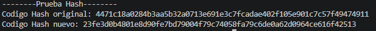
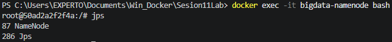
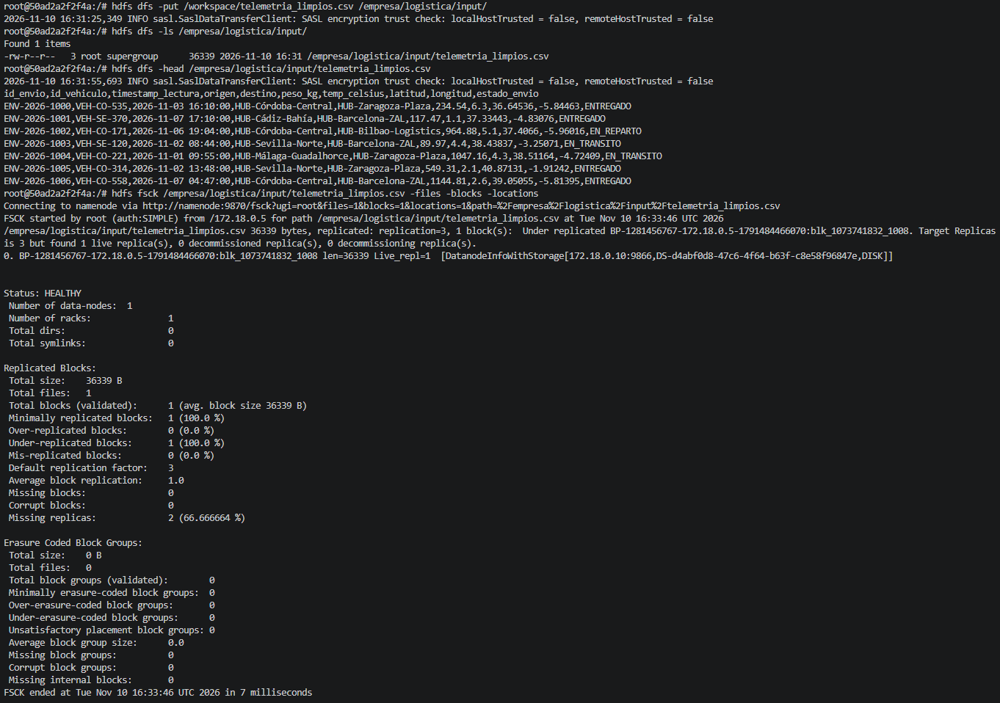
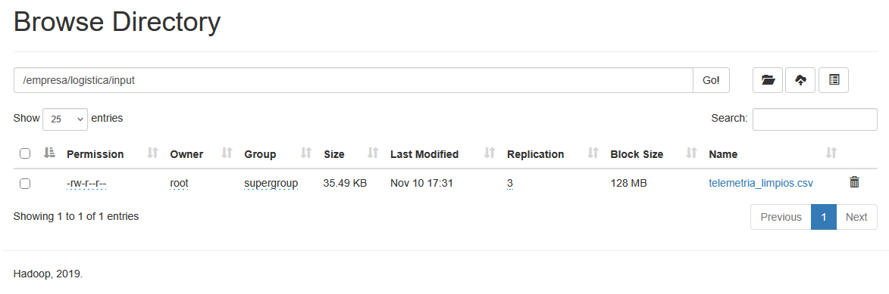

# Práctica Formativa Integradora

## 1.Integridad - Módulo 5075
Comparación de los hashes SHA-256 antes y despues de la limpieza de datos:

Codigo Hash original: 4471c18a0284b3aa5b32a0713e691e3c7fcadae402f105e901c7c57f49474911
Codigo Hash nuevo: 23fe3d0b4801e8d90fe7bd79004f79c74058fa79c6de0a62d0964ce616f42513

## 2.Despliegue y HDFS - Módulo 5074
Primero levantamos el contenedor de hadoop

`docker compose up -d`

Despues entramos al bash de nuesto contenedor (bigdata-namenode)

`docker exec -it bigdata-namenode bash`

Y comprobamos que los daemons de hadoop esten activos

`jps`

Para la ingesta creamos un directorio para subir los datos

`hdfs dfs -mkdir -p /empresa/logistica/input`

Copiamos los datos en limpio al nuevo directorio

`hdfs dfs -put /telemetria_limpia.csv /empresa/logistica/input/` 

Con -ls comprobamos que se han cargado correctamente

`hdfs dfs -ls /empresa/logistica/input/`

Mostramos el contenido de los datos subidos

`hdfs fsck /empresa/logistica/input/telemetria_limpia.csv -files -blocks -locations` 

## 3.Análisis crítico
En HDFS es menos probable que los datos se corrompan debido a que por defecto se realizan 3 copias del mismo fichero. 
De esta forma, si uno de los nodos cae, existen otros 2 nodos que pueden respaldar al original.

## 4.Evidencias gráficas

**Calculo de Hashes SHA256:**  
  

**Servicios JPS:**  
  

**Comandos HDFS fsck:**  
   

**Comprobacion webui browser:**  
   
